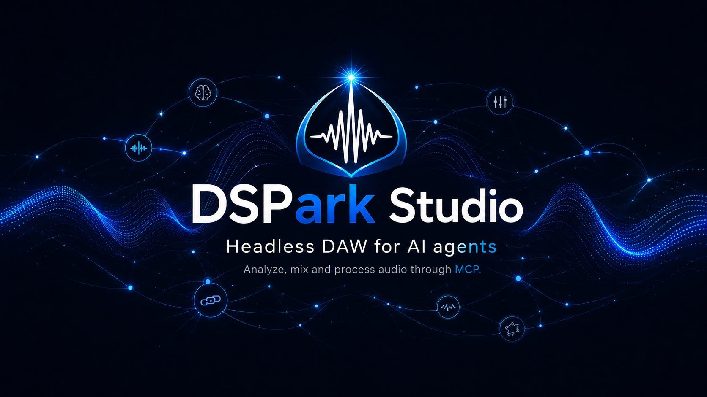

  

<h1 align="center">DSPark Studio</h1>

  <strong>DAW for AI Agents.</strong> 
  From a folder of tracks to a mix and master. Every step editable.

  <a href="https://cristianmoresi.com/dspark-studio">Website</a> &middot;
  <a href="#get-started">Get started</a> &middot;
  <a href="#try-these-production-briefs">Explore examples</a> &middot;
  <a href="#use-studio-in-your-own-application">Build with Studio</a> &middot;
  <a href="#license-and-product-integration">License and integration</a>

**DSPark Studio is a DAW for AI Agents:** a local digital audio workstation
for mixing, mastering, audio analysis, MIDI composition and synthesis.
Its MCP server connects Claude, Codex or another compatible AI agent to the
production tools. Give your agent a folder of tracks and a creative brief;
it can analyze the parts, build a mix and deliver a master. You can also
compose from MIDI, synthesizers and your own samples.

**Built on [DSPark](https://github.com/CristianMoresi/DSPark), the open-source
audio DSP framework created by Cristian Moresi.** DSPark provides the native
audio processing, synthesis and analysis behind Studio.

**You direct the production. Every step stays editable.** Studio runs locally
and connects through MCP (Model Context Protocol). Your agent supplies the
creative decisions; Studio supplies the processing and measurements.

Free for **personal and commercial content creation**, including paid client
work. Incorporating Studio into another product, redistributing it or offering
its processing as a hosted service requires a separate paid agreement.

## What you can do

Explore **54 audio modules and four instrument engines**, with editable
processing chains and automation.

| Work on | Tools at your agent's disposal |
|---|---|
| **Mixing and mastering** | EQ and dynamic EQ, compression and multiband dynamics, de-essing, denoising, transient shaping, offline leveling and limiting. |
| **Space and modulation** | Algorithmic and convolution reverbs, delay and ping-pong echoes, chorus with flanging textures, phaser, tremolo and vibrato. |
| **Character and textures** | Saturation, tape, tube and transformer processing; pitch shifting and correction, granular effects, spectral freeze, ring modulation and frequency shifting. |
| **MIDI composition** | Author notes, chords, bass lines and drum patterns. Quantize, humanize, shape velocities and import or export `.mid` files. |
| **Sound design** | Analog, FM and wavetable synthesizers, plus a multi-zone sampler. Start from editable presets or build layered instruments from scratch. |
| **Arrangement and routing** | Automate levels, pan and effect parameters through the song. Build buses, shared effects, sidechains, stereo doubles and harmonies. |
| **Analysis and delivery** | Inspect loudness, true peak, spectrum, tempo, pitch, key and sections. Compare renders and export a full mix or individual stems. |

Saved projects retain notes, instruments, routing, effects and automation.
Ask for a specific revision and continue from where you left off.

### New in 1.1.0

- **Production guidance included.** Studio supplies your agent with task-specific
  methods for analysis, mixing, mastering, voice treatment, MIDI and sound design.
  No separate skill installation is needed.
- **Save your workflow.** Reuse your own synth sounds with their effects,
  complete processing chains and export recipes alongside factory presets.
- **Compare before committing.** Preview excerpts with level-matched A/B,
  group project edits with undo, and isolate individual instrument layers.
- **Refine the delivery.** Use more precise automation and independent track,
  bus and master oversampling, then inspect measurements of the exported file.

## Try these production briefs

Give your agent local files and the sound you want to achieve.

### A folder of tracks, a finished mix and master

> Mix the tracks in this folder. Analyze each track's dynamic range and
> frequency balance and find where parts mask each other. Choose EQ,
> dynamics, reverb, delay and modulation to fit my artistic direction: clear vocals,
> a punchy rhythm section, intimate verses and wider choruses. Automate the
> balance throughout. Deliver the mix, a separate mastered version and the
> editable project, with final loudness and peak measurements.

Your brief guides the processing, stereo space and section-by-section balance.

### A podcast with a coherent voice-and-music mix

> Mix these two speakers with my music bed. De-ess the voices, tame plosives
> with targeted EQ, and balance the speakers. Duck the music while either
> speaks and add a subtle shared room. Export at -16 LUFS with true peaks
> below -1 dBTP, verify the result, and save the project.

Voice-keyed sidechain compression keeps the music responsive to speech.

### A complete arrangement from MIDI, synths and samples

> Create a synth-pop track at 116 BPM in A minor, with an intro, verse,
> chorus and outro. Write the MIDI for analog bass, layered FM and wavetable
> chords, a lead melody and drums played from my samples. Humanize the groove,
> open the filter in the chorus, and add chorus, reverb and a subtle
> tempo-matched delay. Export the mix, stems, MIDI and editable project.

## Get started

Download DSPark Studio 1.1.0 for your system:

| Platform | Download |
|---|---|
| **Windows 10+ x64** | [Windows installer](https://github.com/CristianMoresi/DSParkStudio/releases/latest/download/DSParkStudio-windows-x64-setup.exe) |
| **macOS 27+ on Apple silicon** | [macOS installer](https://github.com/CristianMoresi/DSParkStudio/releases/latest/download/DSParkStudio-macos-arm64.pkg) |
| **Linux x64** | [Debian package](https://github.com/CristianMoresi/DSParkStudio/releases/latest/download/DSParkStudio-linux-x64.deb) or [portable archive](https://github.com/CristianMoresi/DSParkStudio/releases/latest/download/DSParkStudio-linux-x64.tar.gz) |

See [release notes and SHA-256 checksums](https://github.com/CristianMoresi/DSParkStudio/releases/latest)
for the current version and requirements. Packages are unsigned.

1. **Download** the package for your system from Releases and follow its included guide.
2. **Choose your AI clients.** Native installers list detected clients; available ones start selected. Keep the clients you want, or select none to install only the executable. Restart the selected clients and enable Studio's tools; the included guide covers manual setup and the Linux archive.
3. **Describe the job.** Provide local audio/sample paths or a musical brief. Ask your agent to save the project and check the final render.

**Updating:** run the newer installer over the existing installation. For
the Linux archive, use the setup helper's `update` command as described in
its guide. Restart connected AI clients afterwards so they load the new
executable. Packages do not download updates automatically.

Use an AI client with **local MCP support**. Installer integrations include
Claude Desktop, Claude Code, Codex, VS Code, Gemini CLI and OpenCode, depending
on platform and installation. Model access and data policies belong to your
chosen client.

**Audio:** import WAV, MP3 and FLAC; export WAV and MP3.
**Projects:** save and reopen `.dsproj`; exchange authored MIDI as `.mid`.

## Use Studio in your own application

**The executable includes the MCP server.** Your application can launch
`dspark_studio` (`dspark_studio.exe` on Windows) with the `serve` argument
as a separate local process and communicate over stdin/stdout. You can also
run CLI jobs from scripts. Point your integration at the executable's absolute
path; it works independently of the preconfigured AI clients.

Installation locations depend on the package:

| Package | Installation location |
|---|---|
| **Windows setup** | Choose a dedicated installation folder; the default is `C:\Program Files\DSPark Studio`. |
| **macOS installer** | `/Applications/DSPark Studio` for all users, or `~/Applications/DSPark Studio` for your account. |
| **Linux Debian package** | `/opt/dspark-studio`. |
| **Linux archive** | Choose a user-owned destination with the setup helper's `--destination` option. |

Each package's guide covers its path and permission requirements. Using MCP
clients, scripts or private internal applications for your own content
production is free, including commercial work. Offering a Studio-powered
product or processing platform to others requires a
[separate paid agreement](#license-and-product-integration), even if Studio
runs as a separate process or users download it themselves.

## License and product integration

**Free for personal and commercial content creation** under the
[DSPark Studio License Agreement](LICENSE). Individuals, professionals and
companies can create, publish and sell their work, including client projects,
without a Studio fee, revenue limit or output royalty. Your content remains
yours, subject to rights in any third-party material you use.

**A separate paid agreement is required** to incorporate or redistribute
Studio in another product, offer a dedicated wrapper, or provide its
processing through a hosted service, website or API. This applies even if
that product or service is free. Ordinary MCP clients and internal production
automation remain permitted.

Proprietary software. All rights reserved. Studio's source code remains
private; its license does not transfer the project or brand. DSPark's
separate MIT terms remain unchanged. The full license governs these permissions.

For paid integration, redistribution, hosted-service or acquisition inquiries,
**[contact Cristian Moresi](mailto:cristianmoresiguitar@gmail.com?subject=DSPark%20Studio%20commercial%20inquiry)**.

Created by **Cristian Moresi**, powered by [DSPark](https://github.com/cristianmoresi/DSPark).

[Report a reproducible issue](https://github.com/CristianMoresi/DSParkStudio/issues)
with your OS, Studio version and the steps to reproduce it.
